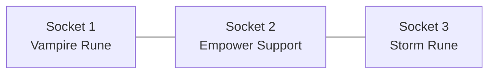

# ✨ Supports and runewords

## Support gems

A support gem does nothing alone. It boosts the gems in the sockets **right next to it**.

Here Empower boosts both runes. With Empower in socket 3 instead, it would only boost the gem in socket 2.

| Support | Effect on linked gems |
|---|---|
| [Empower](../gems/supports.md) | They act as if they had more levels (never above their maximum) |
| [Precision](../gems/supports.md) | Their chance to trigger goes up |
| [Twin](../gems/supports.md) | They can trigger twice |
| [Growth](../gems/supports.md) | They gain more XP |

In the tooltip, a boosted gem shows its bonus, such as `VII (+2)`:

## Runewords

A **runeword** is a sequence of gems. Socket those gems **in that order** in one item and it awakens: the item gains a new power and an aura.

The rules:

- The gems must be in the exact order of the sequence.
- Empty sockets don't matter.
- Any other gem in the item breaks the runeword.
- The level of the gems doesn't matter.

An awakening is an event. A pillar of light rises, a sigil turns in the sky, and the players around are told who awakened what.

The first awakening of each runeword is announced to the whole server. Until then, it shows as `???` in the Codex. See the [list of runewords](../gems/runewords.md), or search for yourself.

Players can use `/eg cinematic on` to make the camera turn around the weapon during an awakening. It is off by default.
